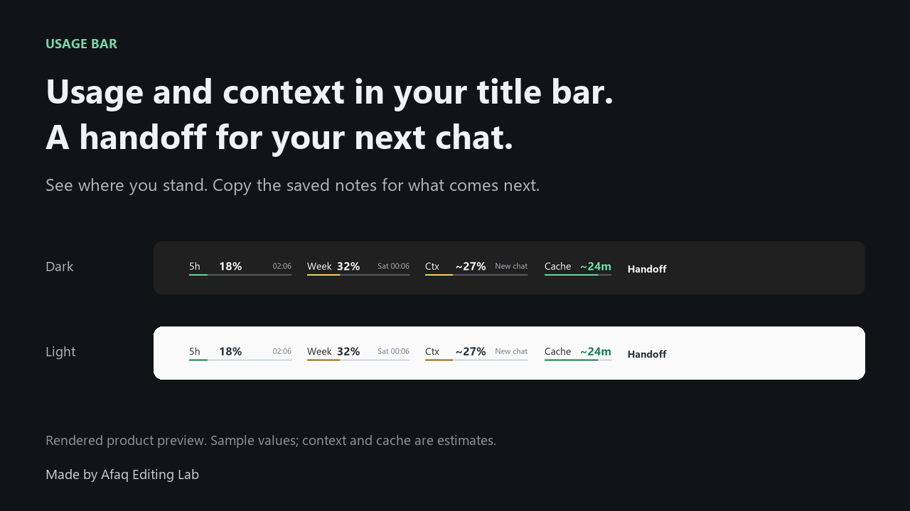

# Usage Bar

**Usage and context in your title bar. A handoff for your next chat.**

See your account usage and estimated chat context while you work. When you're ready for a fresh chat, copy the project state, files to read and next step saved by your assistant. Separate sounds let you know when the assistant reports waiting or finished.



Usage Bar adds a small strip to the foreground ChatGPT/Codex desktop window on Windows. It hides when you switch to another app or minimize the window. Account usage requires optional authorized account access and available data.

## Give your next chat a clear starting point

Click **Handoff** and paste the copied continuation into a new chat. It carries the information your assistant has saved, so the next chat has a project folder, notes to read and a concrete next step.

For example, a fictional handoff could look like this:

```text
Continue this project in a NEW chat.
Previous chat (reference only): Website launch
Before reporting: identify this NEW chat's actual title and estimate its own context. Do not reuse the previous chat title or context below.
Folder: D:\Projects\Website
Read: D:\Projects\Website\PLAN.md, D:\Projects\Website\HANDOFF.md
Current state: Homepage copy approved; contact form still needs testing.
Next step: Test the form, then prepare the launch checklist.
Context: ~27% (estimate)
```

Handoff uses assistant-supplied notes. It does not copy the full conversation or start a new chat automatically. Save useful decisions in your project files and keep the assistant report current.

## Get started

1. Extract the whole package into a permanent, writable folder. Keep `Usage Bar` and `Notifications` beside each other.
2. Open `Usage Bar` and double-click **Check Setup.cmd**. You need Python 3.10 or newer, Tk and Pillow. The package does not install anything for you.
3. Double-click **Start Usage Bar.cmd**, then open ChatGPT/Codex normally. Widen the app window if the bar does not fit.
4. Follow [Assistant setup](docs/ASSISTANT-SETUP.md) to enable chat context, handoffs and status sounds.
5. To keep it available whenever you use the app, run **Enable Auto Start.cmd** once. The helper starts when you sign in to Windows, waits for the app and appears when its window is active. Keep using your normal app icon.

The example configuration disables account reads. You can use local features without enabling them. See [optional account usage](docs/PRIVACY.md#optional-account-usage) before opting in.

[Detailed setup and uninstall](docs/SETUP.md) · [Privacy and account access](docs/PRIVACY.md) · [Troubleshooting](docs/TROUBLESHOOTING.md) · [Release notes](CHANGELOG.md)

## What it does

| Item | What you see | Where it comes from |
| --- | --- | --- |
| 5h and Week | Account usage percentage and local reset time, when available | Optional read-only account request |
| Ctx | Estimated context use for the matched chat | Assistant-written status report |
| Cache | Estimated countdown from the last completed reply | Local 30-minute heuristic, not actual cache telemetry |
| Handoff | Current project, files to read, work state and next step, copied for a new chat | Assistant-written report metadata |
| Sounds | Separate waiting and completion cues | Explicit assistant reports, independent of the visual helper |

Context rails turn yellow at 25% and red at 40%. The cache countdown turns yellow at six minutes remaining and grey when the estimate expires. Missing data appears as a dash. Hold **Alt** and drag the strip horizontally; normal clicks pass through except for Handoff. Drag position is kept for the current window's lifetime.

Handoff works at any context percentage. If the visible chat has no matching report, it copies a clearly incomplete starter rather than another chat's state. Chat-title matching uses local Windows OCR; the app header is refreshed about every 30 seconds. Status reports are checked about twice a second.

The helper adapts to the title-bar surface and prevents duplicate instances within the Windows session. It can remain running while the app is closed. The independent notification process runs only when asked to play a cue.

## Know the limits

- Context is an assistant estimate, not a token meter. Without assistant reporting instructions, Ctx, Cache and Handoff will have limited or missing data.
- Cache is a fixed heuristic from the last completion report. It does not measure cache hits, actual expiration, subscription charges or prompt discounts. A warm timer cannot guarantee cheaper prompts.
- Waiting sounds require the assistant to report waiting before asking. Unexpected native permission prompts are not detected automatically.
- Account usage uses an unofficial application endpoint that may change. Missing, expired or unsupported sign-in data stays unavailable; the tool does not sign in or refresh tokens.
- The Windows app layout, OCR languages, display scaling and window width can affect matching and placement. This is an early source release, not a signed standalone installer. macOS, Linux and browser tabs are unsupported.

## Made by Afaq Editing Lab

I built this for my own workflow. If it helps yours, you're welcome to use it.

If Usage Bar earns a place in your title bar, give the repository a star. Found a problem? Open an issue with the steps to reproduce it, after removing private information.

Free to use and modify under the [MIT license](LICENSE). Usage Bar is an independent project and is not affiliated with or endorsed by OpenAI.
